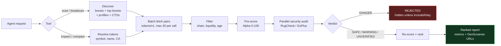

<div align="center">

# dex-alpha-radar

**Real-time meme coin discovery, momentum scoring and anti-rug auditing for AI agents.**<br/>
DexScreener market data · RugCheck + GoPlus contract audits · zero API keys · zero config.

[](LICENSE)
[](https://nodejs.org)
[](mcp-server/tsconfig.json)
[](https://modelcontextprotocol.io)
[](SKILL.md)
[](https://docs.dexscreener.com/api/reference)
[](https://rugcheck.xyz)
[](https://gopluslabs.io)
[](#testing)

<br/>


</div>

> **Research tooling, not financial advice.** Meme coins are extremely high-risk. A passing audit lowers, but never removes, rug-pull risk. The server only reads public data. It never trades, signs or holds keys.

## Why

Most meme coin "scanners" are dashboards you stare at. `dex-alpha-radar` gives your coding or research agent the same eyes, with guard rails:

- **Discovery**: merges DexScreener boosts, top boosts, new profiles and community takeovers, then batch-fetches live pair data.
- **Transparent scoring**: a deterministic 0-100 Alpha Score with a per-component breakdown and plain-English reasons. No black box.
- **Fail-closed security**: Solana (RugCheck) and EVM (GoPlus) audits run on every candidate. If a security API is down or has no data, the token is `UNVERIFIED`, never `SAFE`.
- **Rate-limit safe**: per-endpoint token buckets, a 12 s TTL cache with request de-duplication, and exponential backoff on 429/5xx.
- **Exact prices**: `priceUsd` comes straight from the API as a string. No DOM scraping, no subscript-zero ambiguity.

## Pipeline



## Install

Requirements: **Node.js 20+** and internet access. The first launch installs dependencies and compiles automatically (about 30 s, once).

### `npx skills add` (any Agent Skills-compatible agent)

```bash
npx skills add MONTASSAR2001/dex-alpha-radar
```

Installs the skill (`SKILL.md`: workflow, rules, report templates) into your agent. For live tools, register the MCP server once with the one-liner for your agent below. Without it, the skill falls back to calling the public REST APIs directly.

### Claude Code (plugin / marketplace)

```text
/plugin marketplace add MONTASSAR2001/dex-alpha-radar
/plugin install dex-alpha-radar@dex-alpha-radar
```

The plugin bundles the skill **and** auto-registers the MCP server. Or add only the MCP server:

```bash
git clone https://github.com/MONTASSAR2001/dex-alpha-radar.git
claude mcp add dex-alpha-radar -- node "$(pwd)/dex-alpha-radar/scripts/mcp-launch.mjs"
```

### Antigravity

Open the MCP server manager, choose **Edit raw config**, and add:

```json
{
  "mcpServers": {
    "dex-alpha-radar": {
      "command": "node",
      "args": ["/ABSOLUTE/PATH/TO/dex-alpha-radar/scripts/mcp-launch.mjs"]
    }
  }
}
```

### Gemini CLI

```bash
gemini extensions install https://github.com/MONTASSAR2001/dex-alpha-radar
```

[`gemini-extension.json`](gemini-extension.json) registers the MCP server and loads `SKILL.md` as context.

### Cursor

Add to `~/.cursor/mcp.json` (global) or `.cursor/mcp.json` (project):

```json
{
  "mcpServers": {
    "dex-alpha-radar": {
      "command": "node",
      "args": ["/ABSOLUTE/PATH/TO/dex-alpha-radar/scripts/mcp-launch.mjs"]
    }
  }
}
```

### Windsurf / Devin Local

Add the same block to `~/.codeium/windsurf/mcp_config.json` (or via **Settings → MCP → View raw config**), then refresh the MCP servers.

### From source

```bash
git clone https://github.com/MONTASSAR2001/dex-alpha-radar.git
cd dex-alpha-radar
npm run setup     # install, build mcp-server, typecheck
npm test          # unit tests + live integration tests
npm start         # run the stdio MCP server
```

## MCP tools

All tools return JSON. They are read-only and hit public endpoints only.

### `scan_opportunities`

Aggregates latest boosts, top boosts, latest profiles and CTOs → batch-fetches live pairs → filters → security-audits the strongest candidates → ranks by Alpha Score.

| Parameter | Type | Default | Description |
|---|---|---|---|
| `chain` | string | `"all"` | `solana`, `base`, `ethereum`, `bsc`, `arbitrum`, `polygon`, any DexScreener chain id, or `all` |
| `minLiquidityUsd` | number | `15000` | Minimum pool liquidity |
| `maxAgeHours` | number | `72` | Maximum pair age |
| `includeRisky` | boolean | `false` | Also return tokens whose verdict is `DANGER` (marked `rejected`) |
| `limit` | integer | `10` | Max results (1-25) |

Each result carries: `rank`, `symbol`, `name`, `chain`, `tokenAddress`, `pairAddress`, `url`, exact `priceUsd`, `fdv`, `marketCap`, `liquidityUsd`, `ageHours`, `priceChangePct`, `volumeUsd`, `txns`, `buyRatio`, `links`, `catalysts`, `alphaScore`, `scoreBreakdown`, `reasons`, `rejected`, `security`.

### `inspect_token`

Deep-dive by **symbol, name or contract address** across every DEX pool.

| Parameter | Type | Description |
|---|---|---|
| `query` | string | Symbol (`$WIF`), name, or CA |
| `chain` | string, optional | Restrict to one chain |

Returns the best pool's full metrics (5m/1h/6h/24h price and volume, buy/sell counts, socials), the pool list, a **deep** security audit, the Alpha Score, `otherMatches` and a copycat warning when several tokens share a symbol.

### `audit_token_security`

Standalone deep audit for a Solana mint or EVM contract.

| Parameter | Type | Description |
|---|---|---|
| `chain` | string | `solana`, `ethereum`, `base`, `bsc`, `arbitrum`, `polygon` |
| `address` | string | Mint or contract address |

Returns `status`, `verdict`, `flags`, plus RugCheck fields (`riskScore`, `mintAuthority`, `freezeAuthority`, `topHolderPct`, `top10HolderPct`, `lpLockedPct`) or GoPlus fields (`isHoneypot`, `buyTax`, `sellTax`, `cannotSellAll`, `ownerChangeBalance`, `isOpenSource`).

### `detect_momentum_breakouts`

Finds sudden 5-minute volume surges and buy-pressure spikes (`m5` vs the `h1` baseline) before they top trending charts.

| Parameter | Type | Default | Description |
|---|---|---|---|
| `chain` | string | `"all"` | Chain filter |
| `minLiquidityUsd` | number | `10000` | Minimum liquidity |
| `maxAgeHours` | number | `168` | Maximum pair age |
| `minAcceleration` | number | `2` | Required `(m5 volume x 12) / h1 volume` |
| `minBuyRatio` | number | `0.6` | Required `m5 buys / (buys + sells)` |
| `includeRisky` | boolean | `false` | Include `DANGER` tokens |
| `limit` | integer | `10` | Max results |

A breakout also needs at least 8 transactions, $1k of 5-minute volume and a positive 5-minute price change, so tiny samples cannot trigger it. When nothing qualifies you get the three `nearMisses`.

### `compare_watchlist`

Side-by-side ranking of up to 60 tokens in minimal API calls (30 addresses per DexScreener request).

| Parameter | Type | Description |
|---|---|---|
| `tokens` | `{address, chain?}[]` | Contract addresses; Solana base58 addresses need no chain, EVM addresses without a chain are resolved automatically |
| `defaultChain` | string, optional | Chain applied to tokens that do not set one |

Returns `ranking` (best first, rejected last) and `notFound`.

## How scoring works

Deterministic and fully explained: every result includes `scoreBreakdown` and `reasons`.

| Component | Points | Logic |
|---|---|---|
| **Liquidity health** | 0-25 | Depth: under $5k scores 0, $10k-$25k ramps up, $25k-$500k+ is healthy. Plus liquidity ÷ FDV (≥10% best) |
| **Buy/sell pressure** | 0-25 | `m5` and `h1` buy ratios; 40% buys = 0, 75%+ = max, strong above 60%; small samples discounted |
| **Volume velocity** | 0-25 | `h1 volume ÷ liquidity` turnover (max at 3x) + acceleration `m5 volume × 12 > h1 volume` |
| **Socials / catalysts** | 0-15 | 3 pts each: website, X, Telegram, active DexScreener boost, community takeover |
| **Security** | +10 / -50 | `SAFE` +10 · `WARNING` -5 · `UNVERIFIED` 0 · `DANGER` -50 and **REJECTED** |

Maximum = 25 + 25 + 25 + 15 + 10 = **100**.

## Security audits

| Chain | Provider | `SAFE` | `WARNING` | `DANGER` |
|---|---|---|---|---|
| Solana | RugCheck `report/summary` (full `report` as fallback and for deep audits) | normalised score < 21 | 21 - 40 | > 40, **or** active mint / freeze authority, or marked rugged |
| Ethereum, Base, BSC, Arbitrum, Polygon | GoPlus `token_security` | no flags | tax > 10%, closed source, hidden owner, pausable transfers, missing tax data | honeypot, `cannot_sell_all`, `owner_change_balance`, tax > 30% |
| Anything else / API down / no data | n/a | | | `UNVERIFIED` (never `SAFE`) |

**Fail-closed:** timeouts, HTTP errors, malformed bodies, empty results, unsupported chains and invalid addresses all produce `UNVERIFIED`. Transient failures are never cached.

## Rate limits and caching

| DexScreener endpoint | Documented limit | Sustained rate used | Burst |
|---|---|---|---|
| `token-boosts/latest`, `token-boosts/top`, `token-profiles/latest`, `community-takeovers/latest` | 60 / min each | 48 / min | 9 |
| `tokens/v1`, `latest/dex/search`, `latest/dex/pairs` | 300 / min each | 240 / min | 45 |

Each endpoint has its own token bucket with a FIFO queue, sized so that no 60-second window can exceed 95% of the documented limit. Responses are cached for **12 s**, concurrent identical requests share one network call, and HTTP 429 / 5xx / network errors back off exponentially (honouring `Retry-After`).

## Testing

```bash
npm test                  # unit + live integration
npm run test:unit         # offline, deterministic (mocked fixtures, fake clock)
npm run test:integration  # live DexScreener / RugCheck / GoPlus + stdio launcher handshake
SKIP_LIVE=1 npm test      # skip the live network tests explicitly
npm run validate          # offline manifest checks
claude plugin validate .  # Claude Code manifest validation
```

- **Unit** (`test/unit/`): scoring math, token-bucket pacing, TTL cache, 30-address batch grouping, backoff, RugCheck/GoPlus classification, fail-closed behaviour, all five tools against mocked APIs, and the MCP wiring over an in-memory transport.
- **Integration** (`test/integration/`): real endpoints for schema compatibility, end-to-end tool runs, and a stdio handshake through `scripts/mcp-launch.mjs`. If the network is unreachable the live suites are reported as skipped with the reason.

## Repository layout

```text
SKILL.md                     universal agent skill (workflow, rules, templates)
scripts/mcp-launch.mjs       zero-config launcher: install + build on first start, then stdio
mcp-server/src/
  dexscreener.ts             rate-limited client, token buckets, 12 s TTL cache
  security.ts                RugCheck + GoPlus auditor, fail-closed classification
  scoring.ts                 Alpha Score and breakout detection
  tools.ts                   the five tool implementations
  index.ts                   MCP server (stdio) and tool registration
.claude-plugin/              Claude Code plugin + marketplace manifests
gemini-extension.json        Antigravity / Gemini CLI extension
test/unit, test/integration  tests
```

## Disclaimer

This software is provided for research and education under the MIT license. It is not investment advice. Data comes from third-party APIs that can be delayed, incomplete or wrong. Audits cannot detect every scam. Do your own research and never risk money you cannot afford to lose.

## Author

**Montassar Zarai** · [@MONTASSAR2001](https://github.com/MONTASSAR2001) · [MIT License](LICENSE)
