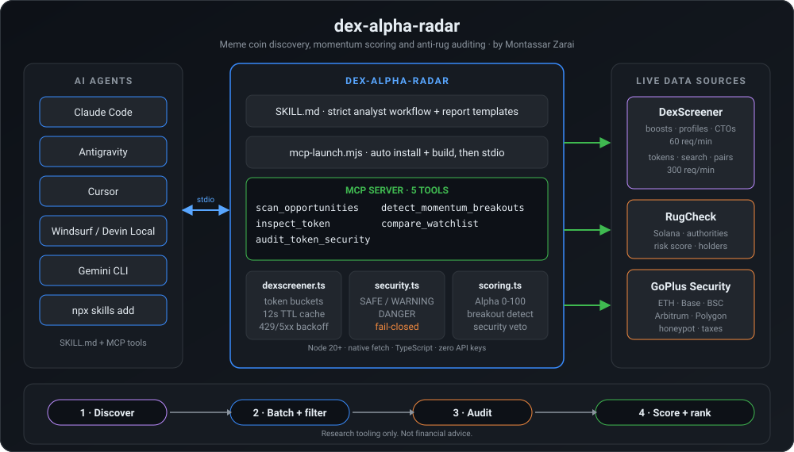
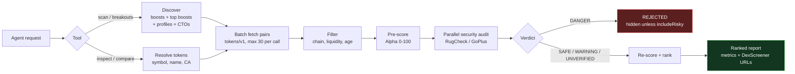

<div align="center">

# dex-alpha-radar

**Real-time meme coin discovery, momentum scoring and anti-rug auditing for AI agents.**<br/>
DexScreener market data · RugCheck + GoPlus contract audits · zero API keys · zero config.

[](LICENSE)
[](https://nodejs.org)
[](mcp-server/tsconfig.json)
[](https://modelcontextprotocol.io)
[](SKILL.md)
[](https://docs.dexscreener.com/api/reference)
[](https://rugcheck.xyz)
[](https://gopluslabs.io)
[](#testing)

<br/>



</div>

> **Research tooling, not financial advice.** Meme coins are extremely high-risk. A passing audit lowers, but never removes, rug-pull risk. The server only reads public data. It never trades, signs or holds keys.

## Why

Most meme coin "scanners" are dashboards you stare at. `dex-alpha-radar` gives your coding or research agent the same eyes, with guard rails:

- **Discovery**: merges DexScreener boosts, top boosts, new profiles and community takeovers, then batch-fetches live pair data.
- **Transparent scoring**: a deterministic 0-100 Alpha Score with a per-component breakdown and plain-English reasons. No black box.
- **Fail-closed security**: Solana (RugCheck) and EVM (GoPlus) audits run on every candidate. If a security API is down or has no data, the token is `UNVERIFIED`, never `SAFE`.
- **Rate-limit safe**: per-endpoint token buckets, a 12 s TTL cache with request de-duplication, and exponential backoff on 429/5xx.
- **Exact prices**: `priceUsd` comes straight from the API as a string. No DOM scraping, no subscript-zero ambiguity.

## Pipeline



## Install

Requirements: **Node.js 20+** and internet access. The first launch installs dependencies and compiles automatically (about 30 s, once).

### `npx skills add` (any Agent Skills-compatible agent)

```bash
npx skills add MONTASSAR2001/dex-alpha-radar
```

Installs the skill (`SKILL.md`: workflow, rules, report templates) into your agent. For live tools, register the MCP server once with the one-liner for your agent below. Without it, the skill falls back to calling the public REST APIs directly.

### Claude Code (plugin / marketplace)

```text
/plugin marketplace add MONTASSAR2001/dex-alpha-radar
/plugin install dex-alpha-radar@dex-alpha-radar
```

The plugin bundles the skill **and** auto-registers the MCP server. Or add only the MCP server:

```bash
git clone https://github.com/MONTASSAR2001/dex-alpha-radar.git
claude mcp add dex-alpha-radar -- node "$(pwd)/dex-alpha-radar/scripts/mcp-launch.mjs"
```

### Antigravity

Open the MCP server manager, choose **Edit raw config**, and add:

```json
{
  "mcpServers": {
    "dex-alpha-radar": {
      "command": "node",
      "args": ["/ABSOLUTE/PATH/TO/dex-alpha-radar/scripts/mcp-launch.mjs"]
    }
  }
}
```

### Gemini CLI

```bash
gemini extensions install https://github.com/MONTASSAR2001/dex-alpha-radar
```

[`gemini-extension.json`](gemini-extension.json) registers the MCP server and loads `SKILL.md` as context.

### Cursor

Add to `~/.cursor/mcp.json` (global) or `.cursor/mcp.json` (project):

```json
{
  "mcpServers": {
    "dex-alpha-radar": {
      "command": "node",
      "args": ["/ABSOLUTE/PATH/TO/dex-alpha-radar/scripts/mcp-launch.mjs"]
    }
  }
}
```

### Windsurf / Devin Local

Add the same block to `~/.codeium/windsurf/mcp_config.json` (or via **Settings → MCP → View raw config**), then refresh the MCP servers.

### From source

```bash
git clone https://github.com/MONTASSAR2001/dex-alpha-radar.git
cd dex-alpha-radar
npm run setup     # install, build mcp-server, typecheck
npm test          # unit tests + live integration tests
npm start         # run the stdio MCP server
```

## MCP tools

All tools return JSON. Discovery, audit and forensics tools are read-only and hit public endpoints. `simulate_or_prepare_trade` writes a local ledger file and, only when you opt in, prepares or signs a Solana swap: see [Trading safety](#trading-safety). `analyze_trade_journal` reads that ledger.

### `scan_opportunities`

Aggregates latest boosts, top boosts, latest profiles and CTOs → batch-fetches live pairs → filters → security-audits the strongest candidates → ranks by Alpha Score.

| Parameter | Type | Default | Description |
|---|---|---|---|
| `chain` | string | `"all"` | `solana`, `base`, `ethereum`, `bsc`, `arbitrum`, `polygon`, any DexScreener chain id, or `all` |
| `minLiquidityUsd` | number | `15000` | Minimum pool liquidity |
| `maxAgeHours` | number | `72` | Maximum pair age |
| `includeRisky` | boolean | `false` | Also return tokens whose verdict is `DANGER` (marked `rejected`) |
| `limit` | integer | `10` | Max results (1-25) |
| `useBrowserTrending` | boolean | `false` | Also read DexScreener's trending view with a local headless Chrome ([details](#optional-browser-trending)) |

Each result carries: `rank`, `symbol`, `name`, `chain`, `tokenAddress`, `pairAddress`, `url`, exact `priceUsd`, `fdv`, `marketCap`, `liquidityUsd`, `ageHours`, `priceChangePct`, `volumeUsd`, `txns`, `buyRatio`, `links`, `catalysts`, `alphaScore`, `scoreBreakdown`, `reasons`, **`warnings`**, **`tradeQuality`**, `rejected`, `security`. When `useBrowserTrending` is set the response also has a `trending` object with the honest status of that source.

### `inspect_token`

Deep-dive by **symbol, name or contract address** across every DEX pool.

| Parameter | Type | Description |
|---|---|---|
| `query` | string | Symbol (`$WIF`), name, or CA |
| `chain` | string, optional | Restrict to one chain |

Returns the best pool's full metrics (5m/1h/6h/24h price and volume, buy/sell counts, socials), the pool list, a **deep** security audit, the Alpha Score, `otherMatches` and a copycat warning when several tokens share a symbol.

### `audit_token_security`

Standalone deep audit for a Solana mint or EVM contract.

| Parameter | Type | Description |
|---|---|---|
| `chain` | string | `solana`, `ethereum`, `base`, `bsc`, `arbitrum`, `polygon` |
| `address` | string | Mint or contract address |

Returns `status`, `verdict`, `flags`, plus RugCheck fields (`riskScore`, `mintAuthority`, `freezeAuthority`, `topHolderPct`, `top10HolderPct`, `lpLockedPct`) or GoPlus fields (`isHoneypot`, `buyTax`, `sellTax`, `cannotSellAll`, `ownerChangeBalance`, `isOpenSource`).

### `detect_momentum_breakouts`

Finds sudden 5-minute volume surges and buy-pressure spikes (`m5` vs the `h1` baseline) before they top trending charts.

| Parameter | Type | Default | Description |
|---|---|---|---|
| `chain` | string | `"all"` | Chain filter |
| `minLiquidityUsd` | number | `10000` | Minimum liquidity |
| `maxAgeHours` | number | `168` | Maximum pair age |
| `minAcceleration` | number | `2` | Required `(m5 volume x 12) / h1 volume` |
| `minBuyRatio` | number | `0.6` | Required `m5 buys / (buys + sells)` |
| `includeRisky` | boolean | `false` | Include `DANGER` tokens |
| `limit` | integer | `10` | Max results |

A breakout also needs at least 8 transactions, $1k of 5-minute volume and a positive 5-minute price change, so tiny samples cannot trigger it. When nothing qualifies you get the three `nearMisses`.

### `detect_fresh_births`

Catches meme coins in their **first minutes** (default 0-20 minutes old, including Minute 0-2 launches), freshest first. Sources, run in parallel: DexScreener latest profiles / boosts / community takeovers, DexScreener search for the newest pairs (`pumpfun`, `pumpswap`, `raydium`, `uniswap`, `aerodrome`, `pancakeswap`) and GeckoTerminal `new_pools` for `solana`, `base`, `ethereum`, `bsc`, `ton`, `arbitrum` (GeckoTerminal indexes pools earlier than DexScreener, so a pool that has no DexScreener pair yet is still returned, with `source: "geckoterminal"`). Candidates are de-duplicated by chain + address (EVM lowercased, Solana case preserved), priced through DexScreener batch lookups, security-audited (RugCheck / GoPlus) and scored.

| Parameter | Type | Default | Description |
|---|---|---|---|
| `maxAgeMinutes` | number | `20` | Maximum pair age (1-180) |
| `chain` | string | `"all"` | Chain filter |
| `minLiquidityUsd` | number | `0` | Minimum liquidity (nothing is hidden for being tiny by default) |
| `limit` | integer | `30` | Max results (1-100) |
| `includeRisky` | boolean | `false` | Include `DANGER` tokens |
| `securityTimeoutSeconds` | number | `12` | How long to wait for audits; unfinished ones are `UNVERIFIED` + `auditPending` and complete in the cache for the next call. EVM audits are batched (20 addresses per GoPlus request) |

Each result has `ageSeconds` / `ageMinutes` (results are sorted by it, ascending), `isMinuteZero` (< 3 min), `pairCreatedAt` (epoch ms) and `pairCreatedAtIso`, `imageUrl`, exact `priceUsd`, `marketCap`, `fdv`, `liquidityUsd`, `volumeUsd {m5,h1,h24}`, `priceChangePct {m5,h1,h6,h24}`, `txns {m5,h1}`, `buyRatio`, `security` verdict, and every direct link: `dexscreenerUrl`, `tradeUrl` + `tradeLabel` (Pump.fun / Raydium / Jupiter / Uniswap / Aerodrome / PancakeSwap / STON.fi / DeDust), `explorerUrl` + `explorerLabel` (Solscan / Basescan / Etherscan / BscScan / Arbiscan / Tonviewer) and `socials {twitter, telegram, discord, websites[], other[]}`.

**Early Birth Velocity** (`velocityScore`, 0-100, with `scoreBreakdown` and `reasons`): 5m buy dominance (25) + 5m volume vs liquidity (20) + 5m price surge (20) + 5m activity depth (15) + verified socials (10) + freshness (10) + security (+10 SAFE, -5 WARNING, -50 DANGER and rejected) minus the wash-trading penalty. Brand-new tokens frequently have no audit data yet: `UNVERIFIED` means unsafe, never safe. Minute-0 launches carry the highest rug risk of anything this skill returns.

### `compare_watchlist`

Side-by-side ranking of up to 60 tokens in minimal API calls (30 addresses per DexScreener request).

| Parameter | Type | Description |
|---|---|---|
| `tokens` | `{address, chain?}[]` | Contract addresses; Solana base58 addresses need no chain, EVM addresses without a chain are resolved automatically |
| `defaultChain` | string, optional | Chain applied to tokens that do not set one |

Returns `ranking` (best first, rejected last) and `notFound`.

### `analyze_whale_forensics`

Holder forensics: who holds the supply, and was the launch bundled?

| Parameter | Type | Description |
|---|---|---|
| `address` | string | Token mint (Solana) or contract (EVM) |
| `chain` | string, optional | Defaults to `solana` for base58 addresses |

Evidence: RugCheck's full report (top holders, **insider wallet networks**, insider-graph size, creator balance, holder count) on Solana, GoPlus holders on EVM, and DexScreener transaction velocity. Liquidity pools, lockers and exchanges are excluded from concentration figures; the creator wallet is not.

**Verdict:** `BUNDLE_DETECTED` if any of: insiders still hold >= 10% of supply, >= 3 insider networks, >= 15 wallets in the insider graph, or >= 20% of supply was routed through insider networks at launch; `CLEAN_DISTRIBUTION` otherwise; `INSUFFICIENT_DATA` when there is no holder report (**fail-closed**, never "clean"). EVM tokens get concentration and a score but always `INSUFFICIENT_DATA` for bundling, because GoPlus has no wallet graph.

**Holder Safety Score (0-100)** starts at 100 and subtracts for top-10 concentration (20% to 70%), top-1 wallet (5% to 30%), creator share, insider holdings, launch distribution through insiders, network count, insider-graph size, wallet churn (more than 8 buys per holder in 24h) and very few holders. A bundled token is capped at 40. Returns `concentration`, `insiders`, `velocity`, `topHolders`, `reasons`, `warnings`. It is a heuristic over public data: bundlers can use wallets nobody has linked yet.

### `evaluate_narrative_pulse`

| Parameter | Type | Description |
|---|---|---|
| `query` | string | Symbol, name or contract address |
| `chain` | string, optional | Restrict to one chain |

- **Narrative momentum (0-100)** from *market attention*: presence in DexScreener's boost/profile/CTO sources (20), volume acceleration and turnover (25), buy pressure (20), price trend (15), boosts and takeovers (10), social listing (10), minus the wash-trading penalty. DexScreener has **no social-post data**, so tweet or chat volume is not measured and the output says so.
- **Copycat risk** compares the token against the ~60 tokens DexScreener is currently surfacing and every other pool with the same ticker, using exact/near-symbol matching (edit distance) and name overlap. `HIGH` (verdict `LATE_COPYCAT`): a token with a matching *name* launched 30+ minutes earlier and is larger or trending, or an older token with only the same *ticker* that is itself trending or boosted. Tickers are not unique, so a ticker-only match with an older, non-trending token is `MEDIUM` ("possibly unrelated, verify the project"), not HIGH. `MEDIUM` also covers an earlier but smaller look-alike, or an identical twin at the same time. `LOW`: only later clones exist. `NONE`. Every match includes its relation, how many minutes earlier it launched, and its liquidity.
- **Social presence (0-100)**: website 30, X 40, Telegram 30. Links come from the DexScreener listing and are checked for the right host and shape (`x.com`/`twitter.com`, `t.me`, an HTTPS project site that is not a link-tree); the accounts themselves are not verified.

### `simulate_or_prepare_trade`

Paper trading by default, with an optional path to a real Solana swap. Actions: `buy`, `sell`, `monitor`, `positions`.

| Parameter | Type | Default | Description |
|---|---|---|---|
| `action` | `buy` \| `sell` \| `monitor` \| `positions` | required | Open, close, apply the guard to open positions, or list the ledger |
| `tokenAddress` | string | | Mint/contract (buy; sell when no `positionId`) |
| `positionId` | string | | Ledger id (sell) |
| `chain` | string | `solana` | Live trades are Solana-only |
| `sizeUsd` | number | `25` | USD swapped into the token |
| `paperMode` | boolean | **`true`** | `false` prepares a real swap |
| `slippageBps` | integer | `200` | 2% |
| `priorityFeeLamports` | integer | `500000` | Solana priority fee (plus the 5000-lamport base fee) |
| `enforceEntryRules` | boolean | `true` | Paper only. `false` records an *experimental* trade, flagged in the journal. Forbidden for live trades |
| `walletPublicKey` | string | burner key's public key | Live: the wallet (e.g. Phantom) that will sign |
| `autoExecute` | boolean | `false` | Live: sign and send with the server's burner key (guardrails below) |
| `sellPercent` | number | `100` | Live unsigned sell: percent of the wallet balance |
| `mode` | `paper` \| `live` \| `all` | `paper` | `monitor` / `positions` filter |

**Paper fills.** The token price comes from a live Jupiter quote (real route and price impact) with the configured slippage added as a cost: buys fill higher, sells fill lower, and an emergency exit uses double slippage. Fees are the base fee plus the priority fee, priced in USD from the live SOL price. If Jupiter or the token decimals are unavailable (or the chain is not Solana) a constant-product liquidity model is used instead, and the result says which path produced the fill.

**Entry rules** (all must pass, otherwise `blocked: true` and nothing is recorded): pair age <= 5 min, security `SAFE`, Alpha Score >= 70, whale forensics `CLEAN_DISTRIBUTION`, no copycat flag (`MEDIUM`/`HIGH`). Unavailable forensics or narrative data **blocks** the trade (fail-closed).

**Trailing Profit Guard**, applied by `monitor` and, for paper positions, by the server's background monitor every 30 s (`DEX_ALPHA_MONITOR_INTERVAL_SEC`, `0` disables):

| Trigger | Action |
|---|---|
| Liquidity down more than 20% from entry | Emergency exit (checked first, double slippage) |
| +100% vs entry fill | Take profit |
| +50% reached | Stop loss moves from -30% to break-even (0%) |
| -30% (or 0% after break-even is armed) | Stop out |

The guard acts on the prices it observes when it runs; a spike and reversal between two checks can be missed, and DexScreener responses are cached for 12 s.

**Live (`paperMode: false`).** Returns `unsignedTransactionBase64`: a Jupiter swap built for your `walletPublicKey` (SOL in, token out) with the expected and minimum token amounts, price impact and `lastValidBlockHeight`. Nothing is signed or sent, and it is not recorded in the ledger. Sign it with Phantom or any wallet that signs base64 versioned transactions.

### `analyze_trade_journal`

| Parameter | Type | Default | Description |
|---|---|---|---|
| `mode` | `paper` \| `live` \| `all` | `paper` | Which trades |
| `since` | ISO date | | Only trades opened on/after it |
| `minSample` | integer | `5` | Minimum closed trades before suggesting anything |
| `onlyRuleCompliant` | boolean | `false` | Exclude trades that bypassed the entry rules |

Returns win rate, net/average/median PnL %, average win/loss, profit factor, fees, the **best chain**, the **best launch-age window** (<=2 min, 2-5, 5-15, 15-60 min, 1-6 h, ...), exit-reason breakdown, best/worst trades and `optimizations`. The optimizer replays closed trades under alternative values of `minAlphaScore`, `maxAgeMinutes`, `takeProfitPct`, `stopLossPct` and `breakEvenTriggerPct` using each trade's recorded entry snapshot and high/low-water marks. A suggestion needs a meaningful improvement (10+ points of summed PnL), at least `minSample` trades left under the candidate, and carries a confidence label (low under 15 trades, medium 15 to 49, high 50+). It is an **in-sample replay on a small sample**: treat suggestions as hypotheses to confirm on new trades. Nothing is applied automatically.

## Trading safety

The trader is built so that the default cannot lose money and the dangerous paths need several deliberate steps:

| Level | What happens | What it takes |
|---|---|---|
| Paper | Simulated fills, local ledger | Nothing: it is the default |
| Prepare | An **unsigned** transaction for your wallet. You review and sign | `paperMode: false` and a `walletPublicKey` |
| Auto-execute | Signed and sent with a burner key | `autoExecute: true` **and** all of the server-side settings below |

Auto-execution settings (server environment only, set by you, never by the agent):

| Variable | Purpose |
|---|---|
| `DEX_ALPHA_ALLOW_LIVE_EXECUTION=true` | Explicit opt-in to signing at all |
| `SOLANA_BURNER_PRIVATE_KEY` | Base58 or JSON-array secret key of a **dedicated** wallet holding only money you can afford to lose |
| `MAX_TRADE_USD` | Hard cap per buy (required; also enforced when only preparing) |
| `DAILY_LOSS_LIMIT_USD` | New auto buys stop once today's realised live losses reach it (required). Exits are never blocked |
| `SOLANA_RPC_URL` | Optional; defaults to the public mainnet endpoint |

How the code protects you (all covered by tests):

- The private key is read from the environment only. There is **no tool parameter** for it, it is never returned, never written to the ledger, and any upstream error text is scrubbed of key-shaped strings.
- A transaction is signed only if the burner is its sole required signer and fee payer (`Refusing to sign` otherwise), and `walletPublicKey` must match the burner.
- Auto-execution **simulates first** and sends only if the simulation succeeds; a transaction that fails on-chain creates no position.
- The entry rules cannot be disabled for live trades, and live positions are never sold by the background monitor: `monitor` only reports `exitSignals` unless you explicitly pass `autoExecute`.
- Signing uses `node:crypto` ed25519 (no wallet libraries); the ledger lives in `~/.dex-alpha-radar/trades.json` (override with `DEX_ALPHA_RADAR_HOME`) with owner-only permissions and atomic writes, and a corrupt file is moved aside rather than overwritten.

**Jupiter hosts.** The documented `https://quote-api.jup.ag/v6` is tried first; when it is unreachable (as it was when this was built) the client fails over to `https://lite-api.jup.ag/swap/v1`, which serves the same request and response shapes, and remembers the dead host for 5 minutes. Set `JUPITER_API_URL` to pin one. Responses report which host answered.

**Limits you should know.** Paper results are not predictive: simulated fills cannot capture failed transactions, front-running bots, or a rug that freezes selling. The live path has been validated against real Jupiter transactions (built, parsed, signed locally and verified), but **no funds were moved while building this**; test with a tiny burner balance first. This is research tooling, not financial advice.

## How scoring works

Deterministic and fully explained: every result includes `scoreBreakdown` and `reasons`.

| Component | Points | Logic |
|---|---|---|
| **Liquidity health** | 0-25 | Depth: under $5k scores 0, $10k-$25k ramps up, $25k-$500k+ is healthy. Plus liquidity ÷ FDV (≥10% best) |
| **Buy/sell pressure** | 0-25 | `m5` and `h1` buy ratios; 40% buys = 0, 75%+ = max, strong above 60%; small samples discounted |
| **Volume velocity** | 0-25 | `h1 volume ÷ liquidity` turnover (max at 3x) + acceleration `m5 volume × 12 > h1 volume` |
| **Socials / catalysts** | 0-15 | 3 pts each: website, X, Telegram, active DexScreener boost, community takeover |
| **Manipulation** | 0 to -20 | Bot / wash-trading penalty, see [below](#anti-wash-trading-and-warnings) |
| **Security** | +10 / -50 | `SAFE` +10 · `WARNING` -5 · `UNVERIFIED` 0 · `DANGER` -50 and **REJECTED** |

Maximum = 25 + 25 + 25 + 15 + 10 = **100**.

### Anti-wash-trading and warnings

Meme coin volume is easy to fake with thousands of micro swaps. Every scored candidate (scan, breakouts, inspect, compare) is checked:

| Signal | Rule | Effect |
|---|---|---|
| Tiny average trade | `volume.h1 / (buys + sells)` below **$15** with at least 50 transactions in 1h | Up to **-12** (full at $1 or less, zero at $15) and a warning such as `Low avg trade size ($4.20) over 500 txns in 1h: possible bot volume` |
| Volume vs liquidity sanity | `volume.h1 > 20x liquidity` while the 1h price change is within ±5% | **-10** and a `possible wash trading` warning |
| Breakouts | A volume surge that trips either signal | Not reported as a breakout (`washSuspected: true`) |

Penalties are capped at -20. DexScreener's public API has no maker counts, so the maker-to-transaction ratio cannot be computed; the two proxies above are used instead. They are heuristics, not proof: a legitimate token with many small retail buys can trip the first one, which is why the result says "possible".

Every candidate also carries a **`warnings`** array, for example:

- `High top-10 holder concentration (48%)` (liquidity pools, lockers and exchanges are excluded from this number; the creator wallet is not)
- `Unverified contract: source code is not open/verified`, `Mint authority is active`, `Sell tax 12%`
- `Security UNVERIFIED: no audit data, treat as unsafe`
- `Thin liquidity ($4.2k)`, `Liquidity is only 0.12% of FDV`, `Very new pair (27 min old)`
- `Ticker $GTA is shared by 2 different tokens in these results (possible copycat)`

`scan_opportunities` pre-ranks candidates with a light audit, then **deep-audits only the final shortlist** so holder-concentration warnings are available without spending the rate limit on every candidate.

## Optional browser trending

DexScreener's public API has no "trending" endpoint (boosts are the closest signal). With `useBrowserTrending: true`, [`browserFallback.ts`](mcp-server/src/browserFallback.ts) opens DexScreener's trending view in a **local headless Chrome/Chromium**, extracts the listed pair addresses, resolves them to tokens through the batch pairs endpoint, and feeds them into the exact same batch fetch, security audit and Alpha Score pipeline.

- **Optional at every level.** `playwright-core` is an optional dependency (no browser is downloaded; an installed Chrome, Chromium or Edge is auto-detected, or set `DEX_ALPHA_CHROME_PATH`). If either is missing, the scan continues with API sources and reports `trending.status: "unavailable"`.
- **It can be blocked, and it is not bypassed.** DexScreener sits behind Cloudflare, which commonly serves a human-verification page to headless browsers. In that case the status is `blocked`, with a message, and the scan continues with API sources. As tested while building this, plain headless Chrome was blocked. This project does not use stealth or fingerprint-spoofing tricks to defeat bot checks. If you want the trending view anyway, run a browser profile where you passed the check yourself: `DEX_ALPHA_BROWSER_PROFILE=~/.dex-alpha-profile DEX_ALPHA_BROWSER_HEADLESS=0`.
- **Never throws.** Statuses: `ok`, `empty`, `blocked`, `unavailable`, `error`.
- The extraction is verified against a real headless browser rendering a client-side page; see [Testing](#testing).

Treat this feature as a best-effort extra. The API pipeline is the reliable core.

## Security audits

| Chain | Provider | `SAFE` | `WARNING` | `DANGER` |
|---|---|---|---|---|
| Solana | RugCheck `report/summary` (full `report` as fallback and for deep audits) | normalised score < 21 | 21 - 40 | > 40, **or** active mint / freeze authority, or marked rugged |
| Ethereum, Base, BSC, Arbitrum, Polygon | GoPlus `token_security` | no flags | tax > 10%, closed source, hidden owner, pausable transfers, missing tax data | honeypot, `cannot_sell_all`, `owner_change_balance`, tax > 30% |
| Anything else / API down / no data | n/a | | | `UNVERIFIED` (never `SAFE`) |

Holder concentration (`topHolderPct`, `top10HolderPct`) ignores AMM vaults, lockers, exchanges (RugCheck `knownAccounts` and market accounts) and, on EVM, contract holders, so a liquidity pool is not mistaken for a whale.

**Fail-closed:** timeouts, HTTP errors, malformed bodies, empty results, unsupported chains and invalid addresses all produce `UNVERIFIED`. Transient failures are never cached.

## Rate limits and caching

| DexScreener endpoint | Documented limit | Sustained rate used | Burst |
|---|---|---|---|
| `token-boosts/latest`, `token-boosts/top`, `token-profiles/latest`, `community-takeovers/latest` | 60 / min each | 48 / min | 9 |
| `tokens/v1`, `latest/dex/search`, `latest/dex/pairs` | 300 / min each | 240 / min | 45 |

Each endpoint has its own token bucket with a FIFO queue, sized so that no 60-second window can exceed 95% of the documented limit. Responses are cached for **12 s**, concurrent identical requests share one network call, and HTTP 429 / 5xx / network errors back off exponentially (honouring `Retry-After`).

## Testing

```bash
npm test                  # unit + live integration
npm run test:unit         # offline, deterministic (mocked fixtures, fake clock)
npm run test:integration  # live DexScreener / RugCheck / GoPlus + stdio launcher handshake
SKIP_LIVE=1 npm test      # skip the live network tests explicitly
npm run validate          # offline manifest + SKILL.md spec checks
claude plugin validate .  # Claude Code manifest validation
npm run verify:svg        # render assets/architecture.svg in headless Chrome and check its geometry
npm run demo              # run the discovery tools through the stdio launcher against live data and print tables
```

- **Unit** (`test/unit/`): scoring math, token-bucket pacing, TTL cache, 30-address batch grouping, backoff, RugCheck/GoPlus classification, fail-closed behaviour, all ten tools against mocked APIs, Solana signing (including refusal cases), Jupiter failover, the entry gate and every guard exit, live-mode lockouts, secret redaction, the trade ledger, journal statistics and the optimizer, and the MCP wiring over an in-memory transport.
- **Integration** (`test/integration/`): real endpoints for schema compatibility, end-to-end tool runs, a stdio handshake through `scripts/mcp-launch.mjs`, the live Jupiter API (a real swap transaction is built, parsed and signed locally with an ephemeral key, never sent), live forensics/narrative, a full paper-trading loop on live data, the browser fallback against a real headless Chrome (local fixture pages: trending rows, a verification interstitial, an unreachable page) plus live dexscreener.com, and the architecture diagram rendered in Chrome. Suites that need the network or a browser are reported as skipped, with the reason, when it is unavailable.
- **Diagram check**: `npm run verify:svg` measures every label's rendered bounding box and fails on clipped text, overlapping labels, text outside the viewBox or partially overlapping boxes.

## Repository layout

```text
SKILL.md                     universal agent skill (workflow, rules, templates)
scripts/mcp-launch.mjs       zero-config launcher: install + build on first start, then stdio
scripts/demo.mjs             live end-to-end demo of the discovery tools
scripts/verify-svg.mjs       geometry checker for the architecture diagram
mcp-server/src/
  dexscreener.ts             rate-limited client, token buckets, 12 s TTL cache
  security.ts                RugCheck + GoPlus auditor, fail-closed classification
  scoring.ts                 Alpha Score, anti-wash-trading, warnings, breakout detection
  browserFallback.ts         optional headless-Chrome trending extraction (degrades gracefully)
  tools/index.ts             discovery tools (+ geckoterminal.ts client)
  tools/whale-forensics.ts   holder / bundle forensics
  tools/narrative-pulse.ts   narrative momentum, copycat risk, social presence
  tools/paper-phantom-trader.ts  paper trading, profit guard, unsigned/auto-executed swaps
  tools/trade-journal.ts     journal statistics and threshold optimizer
  trading/                   ledger, Jupiter client, fills, guard rules, guardrails, Solana signing/RPC
  index.ts                   MCP server (stdio) and tool registration
.claude-plugin/              Claude Code plugin + marketplace manifests
gemini-extension.json        Antigravity / Gemini CLI extension
test/unit, test/integration  tests
```

## Disclaimer

This software is provided for research and education under the MIT license. It is not investment advice. Data comes from third-party APIs that can be delayed, incomplete or wrong. Audits cannot detect every scam. Do your own research and never risk money you cannot afford to lose.

## Author

**Montassar Zarai** · [@MONTASSAR2001](https://github.com/MONTASSAR2001) · [MIT License](LICENSE)
